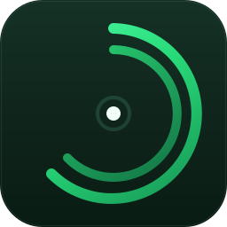
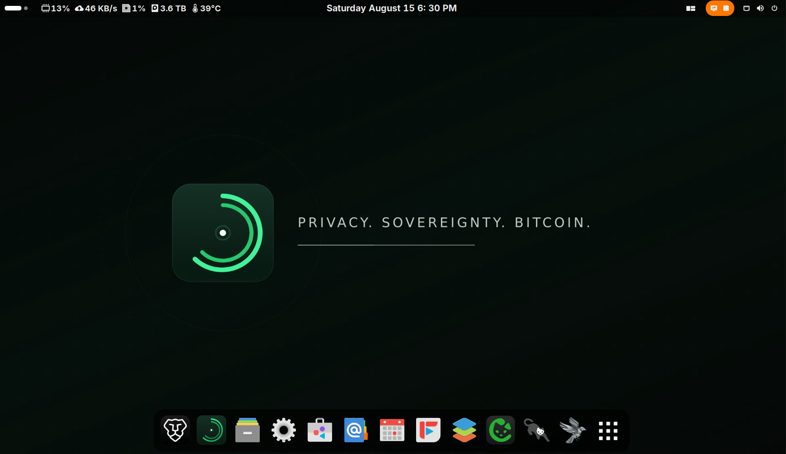
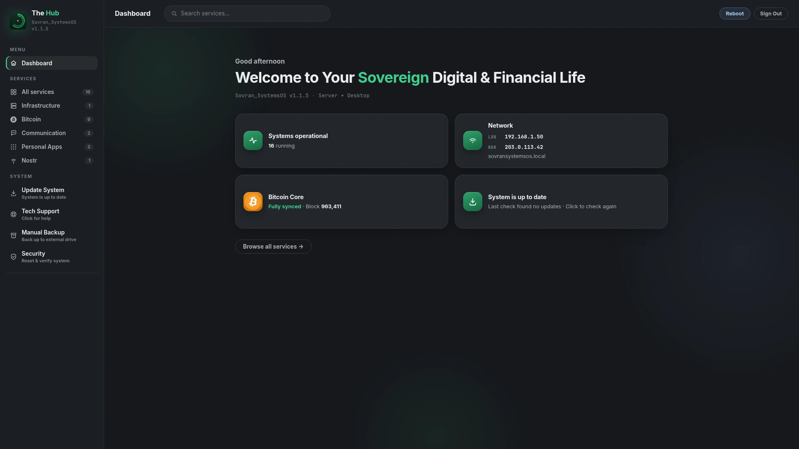

<div align="center">



# Sovran_SystemsOS

### Bitcoin sovereignty. Sovereign computing. One system.

Sovran_SystemsOS is a free and open-source operating system built on
[NixOS](https://nixos.org) for **Bitcoin self-custody** and **sovereign
computing**. Every installation starts with a private desktop and
**[Sparrow Wallet](https://sparrowwallet.com)**, **[Bisq](https://bisq.network)**,
and **[Bisq 2](https://github.com/bisq-network/bisq2)** ready from the first
boot — and scales into your own Bitcoin node, Lightning stack, private cloud,
and communications server when you are ready.

[Website](https://sovransystems.com) ·
[Download ISO](https://downloads.sovransystems.com/Sovran_SystemsOS-1.2.5.iso) ·
[Verify SHA-256](https://downloads.sovransystems.com/Sovran_SystemsOS-1.2.5.iso.sha256) ·
[Install Guide](#install-sovran_systemsos) ·
[Build from Source](#build-from-source)



*Bitcoin sovereignty from the first boot.*

</div>

> **📌 Branch note:** Active development happens on GitHub `main` and Gitea
> `staging-dev`. Audited, release-ready builds live on
> [Gitea `stable`](https://git.sovransystems.com/Sovran_Systems/Sovran_SystemsOS/src/branch/stable).

---

## Contents

- [What is included](#what-is-included)
- [Three modes](#three-modes)
- [The Hub](#the-hub)
- [Install Sovran_SystemsOS](#install-sovran_systemsos)
- [For developers](#for-developers)
- [Security](#security)
- [Acknowledgements](#acknowledgements)
- [License & Contributing](#license--contributing)

---

## What is included

Other projects solve one piece of the puzzle — a wallet distribution, a node-in-a-box,
or a self-hosting stack. Sovran_SystemsOS brings them together on a reproducible,
auditable NixOS foundation controlled from one place.

- **Bitcoin & Lightning** — [Bitcoin Core](https://bitcoin.org),
  [Electrs](https://github.com/romanz/electrs), [Tor](https://www.torproject.org),
  [LND](https://github.com/lightningnetwork/lnd),
  [Ride The Lightning](https://github.com/Ride-The-Lightning/RTL),
  [Alby Hub](https://albyhub.com) (NWC), [BTCPay Server](https://btcpayserver.org),
  optional [Mempool](https://github.com/mempool/mempool) explorer, and
  Sparrow Wallet, Bisq, and Bisq 2 with automatic wallet-to-node connections.
- **Private communications** — [Matrix Synapse](https://github.com/element-hq/synapse)
  and [Element](https://element.io), optional audio/video calling via
  [LiveKit](https://livekit.io), and an optional
  [Haven](https://github.com/bitvora/haven) Nostr relay.
- **Private cloud & web** — [Nextcloud](https://nextcloud.com) (files,
  calendars, contacts), [Vaultwarden](https://github.com/dani-garcia/vaultwarden)
  passwords, [WordPress](https://wordpress.org), [Caddy](https://caddyserver.com)
  reverse proxy, and optional remote desktop.
- **Everyday desktop** — [GNOME](https://www.gnome.org),
  [Brave Origin](https://brave.com/origin/) and
  [Firefox](https://www.mozilla.org/firefox), office and administration tools,
  plus [Mullvad VPN](https://mullvad.net) on the Desktop mode.

> Sovran_SystemsOS provides tools for self-custody and peer-to-peer Bitcoin use.
> You remain responsible for protecting your keys, verifying backups, and
> following applicable laws.

---

## Three modes

Use Sovran_SystemsOS as your **everyday desktop**, or install it on a dedicated
machine as a **headless home server** managed from any browser on your local
network. Every mode shares the NixOS + GNOME base, the Sovran Hub, Sparrow,
Bisq, and Bisq 2.

| Mode | Best for | Included stack | Public exposure |
|---|---|---|---|
| **Desktop** | Everyday computing & modest hardware | Sparrow, Bisq, Bisq 2, Tor, and the stock Mullvad VPN app (unconfigured; disable via `services.mullvad-vpn.enable = lib.mkForce false;` in `custom.nix` if unwanted) | **None.** Publishes nothing on your LAN or the internet; ships with no SSH daemon. |
| **Node** | Running and verifying your own Bitcoin & Lightning node | Desktop stack (minus Mullvad) + Bitcoin Core, Electrs, LND, RTL, BTCPay Server, optional Mempool, and auto-connected wallets | **LAN & Tor by default.** Exposes your home connection's public IP address only if you enable *Put BTCPay Server Online* or *Lightning Wallet Connections*. |
| **Server + Desktop** | Full sovereignty over Bitcoin, cloud, chat, and web | Complete Node stack + Nextcloud, Matrix/Element, Vaultwarden, WordPress, and Caddy domains | **Public internet** (ports 80/443 + Dynamic DNS), so your domain resolves to your home connection's public IP address — a number such as `203.0.113.42`. See [exposure notes](#server--desktop-and-your-home-ip-address). |

### Recommended hardware

| | **Desktop** | **Node** | **Server + Desktop** |
|---|---|---|---|
| **CPU** | 64-bit Intel/AMD (~2015+) | 64-bit Intel/AMD (~3 yrs old or newer) | Same as Node |
| **RAM** | 8 GB | 16 GB | 32 GB |
| **Storage** | 256 GB SSD | 500 GB NVMe (OS) + 2 TB NVMe (timechain) | Same as Node |
| **Network** | Any broadband | Unmetered, ~200 Mbps down / 50 Mbps up | Same as Node + router port forwarding & a domain |

### Server + Desktop and your home IP address

**Server + Desktop publishes services on the public internet, so your domain
resolves to your home connection's public IP address.** This is what the role is
for, and it is the same arrangement as any other self-hosted server on a
residential connection.

> **What "home IP address" means.** Your internet provider assigns your router a
> number, called its public IP address, which looks like `203.0.113.42`. Digit,
> dot, digit. That number is the whole of what this section is about, and it is
> the only thing that enabling public services makes visible.

Enabling public services in **Server + Desktop** (or enabling *Put BTCPay
Server Online* / *Lightning Wallet Connections* in **Node**) points a
[Njal.la](https://njal.la) Dynamic DNS record at your home internet connection
and opens ports 80 and 443 for HTTPS via Caddy. As a result:

- **Your domain's `A` record holds that number.** A DNS lookup returns the
  digits, which is what lets a browser anywhere in the world find your services.
  Registrar WHOIS privacy does not change this; DNS records are public by design.
- **A lookup returns digits, plus the name of the provider that owns them.** An
  IP lookup service can tell you which internet provider the number belongs to
  and, from that provider's public registration records, name a broad region
  such as a city or the provider's service area.
- **The number belongs to your internet connection, not to you personally.**
  Only your provider can link an address to a customer account, and it does not
  publish that information. Nothing in a domain record carries a name, a contact
  detail, or a location.
- **Open ports receive routine background traffic.** Internet-wide scanners
  probe 80/443 continuously on every public address, so expect log noise and
  automated login attempts. Only the enabled services answer, each behind its
  own authentication, and backends stay bound to loopback.
- **Your service hostnames are visible in Certificate Transparency logs**
  (e.g. `vault.yourdomain.com`), because certificates are issued publicly.

None of the above is specific to this system, and none of it is prevented by
running services here rather than elsewhere. What you are choosing is where your
services run, not whether they are exposed. Confirm your ISP allows port
forwarding and that you can configure your router before choosing Server +
Desktop. If you would rather not publish your home IP address at all, choose
**Desktop** or **Node** (with public features left off), or put a reverse proxy
on a remote host in front of the machine.

<details>
<summary><strong>How Dynamic DNS & certificates work under the hood</strong></summary>

- You create a Dynamic DNS record at Njal.la and paste its `njal.la` update URL
  into the Hub.
- `sovran-ddns-update` updates the record on save, 2 minutes after boot, and
  every 15 minutes (`modules/core/njalla.nix`).
- When a domain-backed service is enabled, the firewall opens TCP/UDP 80 and 443
  so Caddy can obtain public TLS certificates (`modules/core/caddy.nix`). The
  Hub lists any extra ports required by specific features.

</details>

---

## The Hub

The **Sovran Hub** is the built-in control center for your machine — available
as a desktop app and, on **Node** and **Server + Desktop**, from any browser on
your local network at `http://sovransystemsos.local:8937` (protected by login
and restricted to local/LAN addresses).

- Start, stop, and monitor Bitcoin, Lightning, and self-hosted services
- Toggle system features and configure domains and credentials
- Run system updates and integrity checks without touching the terminal
- Grant optional, time-limited **Tech Support** access on Node and Server +
  Desktop (requires enabling SSH Remote Access, which is off by default;
  Desktop ships with no SSH or support account — see
  [`SECURITY.md`](SECURITY.md#restricted-support-access))



---

## Install Sovran_SystemsOS

> **Want to try it without touching your current PC?** Boot the ISO in a
> virtual machine (VirtualBox, VMware, QEMU/KVM, or Proxmox) first — expand
> *Installing in a virtual machine* below for recommended settings. Don't store
> real funds or sensitive keys in a trial VM.

1. **Download** both the installer image and its checksum:
   - [Sovran_SystemsOS-1.2.5.iso](https://downloads.sovransystems.com/Sovran_SystemsOS-1.2.5.iso)
   - [Sovran_SystemsOS-1.2.5.iso.sha256](https://downloads.sovransystems.com/Sovran_SystemsOS-1.2.5.iso.sha256)
2. **Verify the SHA-256 checksum** before flashing. **Stop if it does not match.**
3. **Flash to a USB drive** using [Balena Etcher](https://etcher.balena.io)
   (flashing erases the selected USB drive).
4. **Boot from USB** via your computer's boot menu (`F12`, `F11`, `F10`, `F9`,
   `Esc`, or `Delete`), choose your mode and target disk carefully, and complete
   the guided installer. **Back up any important data first.**
5. **Open the Sovran Hub** from the desktop, or from another device on the same
   LAN at `http://sovransystemsos.local:8937` (Node and Server + Desktop).

<details>
<summary><strong>Checksum verification commands (Linux, macOS, Windows)</strong></summary>

Keep both downloaded files in the same folder:

- **Linux:**
  ```bash
  sha256sum --check Sovran_SystemsOS-1.2.5.iso.sha256
  # Expected: Sovran_SystemsOS-1.2.5.iso: OK
  ```
- **macOS:**
  ```bash
  shasum -a 256 Sovran_SystemsOS-1.2.5.iso
  ```
- **Windows (PowerShell):**
  ```powershell
  Get-FileHash .\Sovran_SystemsOS-1.2.5.iso -Algorithm SHA256
  ```
  Compare the output hash on macOS/Windows with the contents of
  `Sovran_SystemsOS-1.2.5.iso.sha256`.

</details>

<details>
<summary><strong>Installing in a virtual machine</strong></summary>

- **RAM:** 8 GB+ for Desktop (16 GB for Node, 32 GB for Server + Desktop).
- **Disks:** 256 GB+ virtual OS disk (thin/dynamically allocated is fine),
  attached as VirtIO, SATA, SCSI, or NVMe (USB-attached disks are hidden by the
  installer). Add a second 2 TB virtual disk if testing Node or Server + Desktop.
- **Firmware & network:** UEFI preferred (falls back to GRUB on legacy BIOS);
  use NAT or bridged networking with internet access.

</details>

<details>
<summary><strong>Troubleshooting local Hub access & guided help</strong></summary>

If `http://sovransystemsos.local:8937` does not open on another device:
1. Confirm you are running **Node** or **Server + Desktop** (Desktop does not
   expose the Hub on the LAN).
2. Give the machine a few minutes to finish booting, and include `:8937` in the URL.
3. Ensure both devices are on the same LAN (not guest Wi-Fi) and temporarily
   pause any active VPN on the client device.

Prefer guided setup, pre-configured hardware, or Royal Membership? Visit
[sovransystems.com](https://sovransystems.com).

</details>

---

## For developers

Sovran_SystemsOS is a Nix flake combining NixOS, the standalone
[Sovran_Bitcoin](https://github.com/naturallaw777/Sovran_Bitcoin) flake input
(bridged via `modules/sovran-bitcoin-integration.nix`), desktop Bitcoin clients
from [btc-clients-nix](https://github.com/emmanuelrosa/btc-clients-nix), and a
Python/FastAPI + vanilla JS Sovran Hub (`app/`).

### Build from source

Requires Nix with flakes enabled. Clone `stable` from Gitea for release builds
(or GitHub `main` for active development):

```bash
git clone -b stable https://git.sovransystems.com/Sovran_Systems/Sovran_SystemsOS.git
cd Sovran_SystemsOS

nix build .#nixosConfigurations.sovran_systemsos-iso.config.system.build.isoImage
```

The built ISO is linked under `./result`.

<details>
<summary><strong>Common NixOS & release commands</strong></summary>

```bash
# Build / test / activate system configuration from flake root
nixos-rebuild build --flake .#nixos
sudo nixos-rebuild test --flake .#nixos
sudo nixos-rebuild switch --flake .#nixos
sudo nixos-rebuild boot --flake .#nixos

# Roll back last generation or update pinned inputs
sudo nixos-rebuild switch --rollback
nix flake update

# Cut a stable release (syncs main/staging-dev → stable, tags, updates VERSION & README)
./scripts/release-stable.sh [version]
nix build .#nixosConfigurations.sovran_systemsos-iso.config.system.build.isoImage
./scripts/upload-cdn.sh --upload
```

</details>

### Repository layout

| Path | Purpose |
|---|---|
| `flake.nix` / `flake.lock` | Pinned inputs, system outputs, and ISO build definitions |
| `configuration.nix` | Base host, boot, GNOME desktop, users, security, and backups |
| `modules/core/` | Roles, Hub service, Caddy, DDNS, desktop wiring, support, remote deploy |
| `modules/sovran-bitcoin-integration.nix` | OS-specific overrides for the `Sovran_Bitcoin` flake input |
| `modules/*.nix` | Self-hosted services (Synapse, LiveKit, Haven, Nextcloud, Vaultwarden, WordPress), wallet autoconnect, RDP, SSH, Mullvad |
| `app/` | Sovran Hub FastAPI backend, scripts, templates, and web UI |
| `iso/` | Installer configuration, UI, and assets |
| `scripts/` · `tests/` | Release/CDN automation and Nix/security integration tests |
| `custom.template.nix` | Template for per-machine `/etc/nixos/custom.nix` overrides (`role-state.nix`, `custom.nix`, and `hardware-configuration.nix` are generated per install) |

---

## Security

- **Hardened defaults:** Pinned flake inputs, firewall on by default, SSH and
  remote desktop off by default (no SSH daemon at all on Desktop), isolated
  service accounts with systemd sandboxing, and Tor enforcement across Bitcoin
  services.
- **Self-custody hygiene:** Never share seed words with anyone (including
  support). Use a dedicated hardware signer for meaningful balances, keep
  verified offline backups in separate locations, and test recovery early.

Read [`SECURITY.md`](SECURITY.md) for the full threat model, Desktop SSH notes,
and private vulnerability reporting.

---

## Acknowledgements

Sovran_SystemsOS builds on the work of the free and open-source community:

- **[NixOS](https://nixos.org) & Nixpkgs** for the declarative, reproducible
  operating system foundation.
- **[Emmanuel Rosa (`btc-clients-nix`)](https://github.com/emmanuelrosa/btc-clients-nix)**
  for packaging Sparrow Wallet, Bisq, and Bisq 2.
- **[nix-bitcoin](https://github.com/fort-nix/nix-bitcoin)** (adapted from
  [`360e30f`](https://github.com/fort-nix/nix-bitcoin/commit/360e30fee5ba32f9fecc89bc35628195d9d2dbbe);
  MIT notice in [`THIRD_PARTY_NOTICES.md`](THIRD_PARTY_NOTICES.md)).
- The upstream maintainers behind Bitcoin Core, Electrs, LND, RTL, Alby Hub,
  BTCPay Server, Tor, GNOME, Caddy, Matrix Synapse, Element, LiveKit, Nextcloud,
  Vaultwarden, WordPress, and every package in the stack.

---

## License & Contributing

Licensed under the **[GNU Affero General Public License v3.0](LICENSE)**
(without warranty). Network operators running modified versions of covered
components such as the Sovran Hub must make corresponding source code available
under AGPL-3.0. Upstream packages retain their own licenses; see [`LICENSE`](LICENSE)
and [`THIRD_PARTY_NOTICES.md`](THIRD_PARTY_NOTICES.md).

Contributions are welcome on
[GitHub](https://github.com/naturallaw777/Sovran_SystemsOS) — please read
[`CONTRIBUTING.md`](CONTRIBUTING.md) for branch workflow and commit-message
conventions before opening a pull request.
